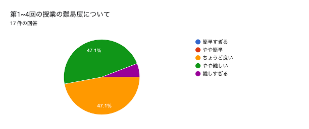
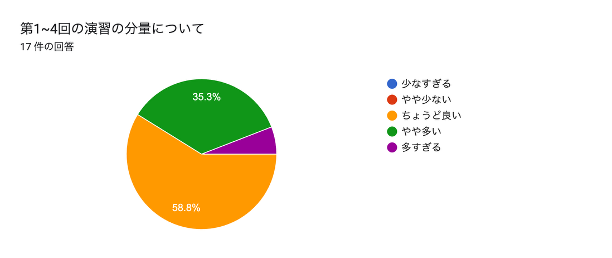
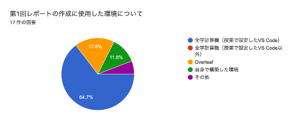
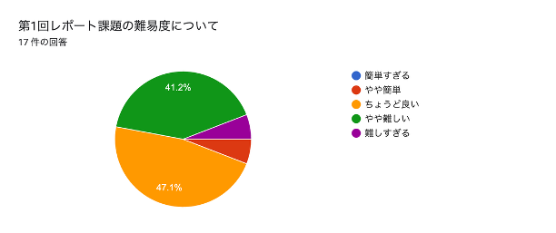
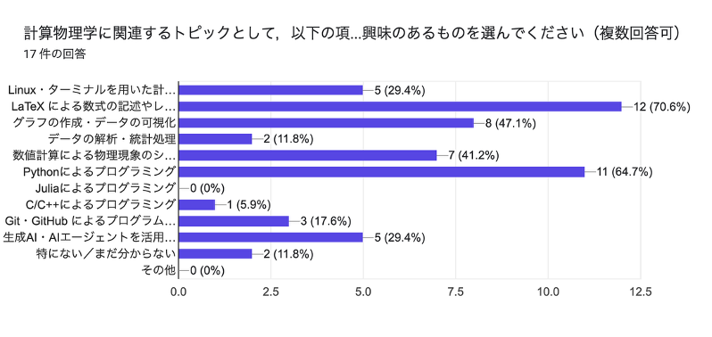

# 第1回アンケート結果

### 回答件数: 17

### 授業・演習に関する感想・要望

> 授業資料の中にやるべきことがわかりやすく書かれているのが助かった。

良かったです

> pdfの指示が的確で分かりやすい

ありがとうございます

> 授業についていくのが精一杯だと感じている

第1~4回にかけては、毎回新しいツールが出てきて大変だったと思います。使っていくうちに必ず慣れていくと思うので、しばし忍耐強くやってみてください。

> 少し説明が速いように感じました。

すみません。演習中にフォローしますので、気軽に声をかけてください。

> 授業中に終わらなかった演習に授業時間外に取り組もうとしたが、そもそも授業資料の開き方を覚えていなかった（cdでcompphys2に入るなど）ためできなかったことがあったのでmanabaなどに授業資料の開き方だけでも載せて頂けると幸いです。

授業資料については、[こちらのページ](https://github.com/akiyama-es/compphys2)からすべて閲覧することができます。
授業では、ターミナルに慣れてもらうために、コマンドラインからすべて資料を閲覧してもらっていますが、自習される際には、上のページも適宜活用してもらえると幸いです。

### 上で「その他」を選んだ場合，使用した環境について教えてください

> Cloud LateX

### レポート課題に関する感想・要望

> latex書くのが慣れなかった

この点については、第1回レポートが一番大変だと思います。ぜひ、今後のレポート課題でもLaTeXを使い続けてみてください。しばし忍耐強く、よろしくお願いします。

